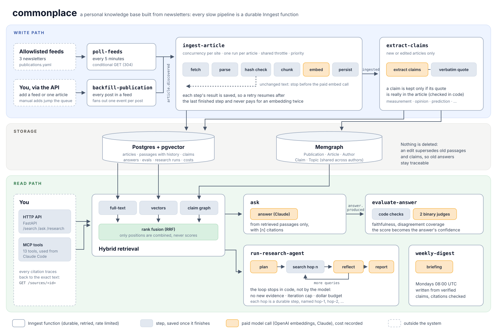

# commonplace

A personal knowledge base built from what I read. It ingests newsletters (and later books
and PDFs), keeps them fresh, and answers questions with citations I can click and check.

Every slow pipeline runs as durable [Inngest](https://www.inngest.com) steps, so a crash
or a provider outage resumes where it stopped instead of starting over (and paying twice).

What it does:

- **Ingests** allowlisted feeds: fetch, parse, chunk, embed, store, idempotently and
  under flow control. Feeds are polled every five minutes; an edited article keeps
  its history.
- **Searches** three ways at once (keywords, vectors, a claim graph), fused by rank.
- **Answers** questions from retrieved passages only, with inline citations that
  trace back to the exact source text.
- **Extracts claims** from every article, each backed by a verbatim quote that code
  checks against the article, and links them through topics in a graph.
- **Scores every answer** with checks in code and two calibrated binary judges.
- **Researches** harder questions with a bounded multi-search agent, and writes a
  **weekly digest** of what was published.

## Architecture



Everything in the write path, plus research, evaluation and the digest, runs as Inngest
functions made of steps. A finished step never runs again on retry, so a crash after
the embedding call does not pay for it twice. Nothing is deleted: an edited article
supersedes its old passages and claims.

## Stack

- **FastAPI** for the HTTP API
- **Inngest** for durable, retryable, rate-limited pipelines
- **Postgres + pgvector** for text, embeddings and full-text search in one place
- **Claude** for answers grounded in the retrieved passages, and for extracting claims
- **Memgraph** for the claim graph: authors, claims and the topics that connect them
- **uv**, **ruff**, **mypy**, **pytest**

## Getting started

Requirements: Docker, [uv](https://docs.astral.sh/uv/), an OpenAI API key (embeddings)
and an Anthropic API key (answers).

```bash
cp .env.example .env    # fill in OPENAI_API_KEY and ANTHROPIC_API_KEY
make start              # containers, migrations, then the app in the foreground
make check              # lint, types, tests
```

| Tool | URL |
|---|---|
| API docs | http://localhost:8000/docs |
| Inngest dev server | http://localhost:8288 |
| Adminer (Postgres) | http://localhost:8081 |
| Memgraph Lab (the claim graph) | http://localhost:3000 |

## Using it

```bash
# ingest every post in an allowlisted feed (returns at once)
curl -X POST localhost:8000/publications -H 'content-type: application/json' \
  -d '{"feed_url": "https://www.latent.space/feed"}'
curl localhost:8000/jobs/<event_id>                      # progress

# ingest one article now, ahead of any queued backfill
curl -X POST localhost:8000/articles -H 'content-type: application/json' \
  -d '{"url": "https://www.latent.space/p/<post-slug>"}'

# search: hybrid (default), sparse or dense
curl 'localhost:8000/search?q=formal+verification'
curl 'localhost:8000/search?q=formal+verification&mode=sparse'

# ask a question, get an answer with citations
curl -X POST localhost:8000/ask -H 'content-type: application/json' \
  -d '{"question": "What are the main approaches to evaluating LLMs?"}'

# show that replaying every backfill writes nothing new
uv run python scripts/replay_backfill.py --verify
uv run python scripts/replay_backfill.py --all

# trace a citation (a claim_id or passage_id) back to its exact source text
curl localhost:8000/sources/<id>

# extract claims for articles that have none yet (new articles do this on their own)
uv run python scripts/enrich_backlog.py

# check the feeds for new articles now (they are also polled every five minutes)
curl -X POST localhost:8288/e/dev -H 'content-type: application/json' \
  -d '{"name": "cp/feed.poll", "data": {}}'
```

Feeds must be listed in [`publications.yaml`](publications.yaml). `/ask` needs
`ANTHROPIC_API_KEY`; without it the retrieved passages are returned on their own.

## Research and the weekly digest

```bash
# a question that needs several searches: returns a research_id at once
curl -X POST localhost:8000/research -H 'content-type: application/json' \
  -d '{"question": "How do the authors differ on open-weight models catching up?"}'
curl localhost:8000/research/<research_id>     # status, then the report and how it was made

# optional bounds: rounds of searching (1-5) and dollars for planning and reflection
#   -d '{"question": "...", "max_iterations": 2, "max_usd": 0.3}'

curl -X POST localhost:8000/digests/run        # write the digest now (it also runs Mondays 08:00 UTC)
curl localhost:8000/digests/latest
```

A research run takes about a minute and costs roughly $0.15 to $0.30 with the
default model. It stops for one of five stated reasons, which it reports. See
[`docs/notes/06-research-digest-deploy.md`](docs/notes/06-research-digest-deploy.md).

## Evaluation

Every answer is scored shortly after it is given: checks in code, then two binary
judges (faithfulness, and disagreement coverage). The score becomes the answer's
`confidence`.

```bash
curl localhost:8000/evals/latest                           # pass rates, failure modes, recent failures
curl -X POST localhost:8000/evals/run                      # compare the four retrieval variants

uv run python scripts/calibrate_judges.py --mode offline   # the checks in code against labelled traces
uv run python scripts/calibrate_judges.py --mode live      # also the judges (about 25 model calls)
```

The failure modes are defined in [`evals/taxonomy.yaml`](evals/taxonomy.yaml), the
benchmark questions in [`evals/golden_benchmark.yaml`](evals/golden_benchmark.yaml).
Results and their caveats are in
[`docs/notes/05-evaluation.md`](docs/notes/05-evaluation.md).

## Using it from Claude Code (MCP)

`cp-mcp` serves the knowledge base as thirteen MCP tools over stdio: `cp_search`,
`cp_ask`, `cp_sources`, `cp_research`, `cp_research_result`, `cp_weekly_digest`,
`cp_eval_report`, `cp_list_publications`, `cp_job_status`, `cp_health`,
`cp_add_publication`, `cp_backfill` and `cp_sync`. [`.mcp.json`](.mcp.json) registers it for Claude Code
when Claude Code is started in this directory (it asks once before enabling it).
From anywhere else:

```bash
claude mcp add commonplace -- uv run --directory /path/to/commonplace cp-mcp
```

The stack (`make start`) has to be running.

## Deploying

```bash
# needs POSTGRES_PASSWORD, INNGEST_EVENT_KEY, INNGEST_SIGNING_KEY, OPENAI_API_KEY and
# API_TOKEN in .env (ANTHROPIC_API_KEY for answers); it refuses to start without them
docker compose -f infra/docker-compose.prod.yml --env-file .env up -d --build
```

This runs the app, Postgres and Memgraph in containers against Inngest Cloud. Then
sync `https://<your-host>/api/inngest` in the Inngest Cloud dashboard. Every route
except `/health` and `/api/inngest` requires `Authorization: Bearer <API_TOKEN>`.
Put TLS in front of it. The sync with Inngest Cloud itself has not been tested
here (see the phase 6 notes).

To use Inngest Cloud while running the app locally, set `INNGEST_DEV=0` and both
keys in `.env`; `make start` then leaves the local dev server out. The app has to
be reachable from Inngest Cloud.

## Tests

`make test` runs everything. Unit tests need nothing. The tests in
`tests/integration/` use the real Postgres from `make up`, each inside a
transaction that is rolled back, and are skipped when it is not running. The graph
tests need Memgraph and clean up the few nodes they create.

## How it was built

In six phases, each with build notes in [`docs/notes/`](docs/notes/): what was
built, what went wrong, and what was measured.

| Phase | Notes |
|---|---|
| 1 | [Durable ingest](docs/notes/01-durable-ingest.md) |
| 2 | [Flow control, hybrid search, cited answers](docs/notes/02-flow-control-and-answers.md) |
| 3 | [Freshness, history, failures, MCP](docs/notes/03-freshness-history-mcp.md) |
| 4 | [Claims and the graph](docs/notes/04-claims-and-graph.md) |
| 5 | [Evaluation](docs/notes/05-evaluation.md) |
| 6 | [Research agent, weekly digest, deployment](docs/notes/06-research-digest-deploy.md) |

A one-page summary is in [`WRITEUP.md`](WRITEUP.md).
